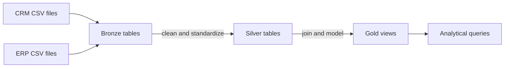

# SQL Data Warehouse Project

[](https://www.microsoft.com/sql-server)
[](https://learn.microsoft.com/sql/t-sql/language-reference)
[](LICENSE)

An end-to-end **SQL Server** data warehouse for CRM and ERP sales data. It loads source CSVs into Bronze, cleans and standardizes them in Silver, then presents customer, product, and sales views in Gold.

**Stack:** Microsoft SQL Server 2022 · T-SQL · Docker Compose  
**Sources:** CRM and ERP CSV files in `datasets/`

## Contents

- [Architecture](#architecture)
- [What’s included](#whats-included)
- [Repository layout](#repository-layout)
- [Documentation](#documentation)
- [Prerequisites](#prerequisites)
- [Setup and run](#setup-and-run)
- [Tests and data quality checks](#tests-and-data-quality-checks)
- [About me](#about-me)

## Architecture



- **Bronze** stores source records loaded from the CSV files.
- **Silver** applies cleaning and standardization.
- **Gold** exposes customer and product dimensions and a sales fact view.

The SQL implementation is under `scripts/`; the database container mounts `datasets/` read-only at `/datasets` for bulk loading.

## What’s included

- SQL Server database and Bronze, Silver, and Gold schemas.
- Bulk-load procedure for the CRM and ERP CSV inputs.
- Silver-layer transformation procedure.
- Gold views: `gold.dim_customers`, `gold.dim_products`, and `gold.facts_sales`.
- SQL scripts for data quality checks and Gold-layer checks under `tests/`.

## Repository layout

```text
.
├── datasets/
│   ├── source_crm/       # Customer, product, and sales CSV files
│   └── source_erp/       # Customer, location, and category CSV files
├── scripts/
│   ├── init_database.sql
│   ├── bronze/           # Bronze table definitions and load procedure
│   ├── silver/           # Silver table definitions and transformation procedure
│   └── gold/             # Analytical view definitions
├── docs/                 # Project scope, lineage, model, catalog, and checks
├── tests/                # SQL load and quality-check scripts
├── docker-compose.yml    # SQL Server 2022 container configuration
├── .gitignore            # Excludes the local .env and .vscode/ file
└── LICENSE
```

## Documentation

- [Project overview](docs/project_overview.md) — goals, scope, and current limitations.
- [Data architecture](docs/data_architecture.md) — system components and medallion layers.
- [Data flow](docs/data_flow.md) — source-to-table lineage through the warehouse.
- [Data model](docs/data_model.md) — Gold views, fields, and logical relationships.
- [Data catalog](docs/data_catalog.md) — source files, layer tables, and Gold outputs.
- [Data quality checks](docs/data_quality_checks.md) — what the SQL check scripts inspect and important execution notes.
- [Naming conventions](docs/naming_conventions.md) — naming patterns observed in the current scripts.

## Prerequisites

- Docker Engine with the Docker Compose plugin.
- A SQL Server client capable of connecting to a SQL Server instance.

## Setup and run

### 1. Configure the SQL Server password

The Compose configuration requires `MSSQL_SA_PASSWORD` from a local `.env` file. The `.env` file is ignored by Git.

Create `.env` in the repository root with a strong SQL Server password:

```dotenv
MSSQL_SA_PASSWORD=replace_with_a_strong_password
```

Do not commit the real password.

### 2. Create the persistent Docker volume and start SQL Server

The Compose file uses the external named volume `sqlserver-data`; create it once before starting the service:

```bash
docker volume create sqlserver-data
docker compose up -d
```

This starts the SQL Server 2022 container and publishes port 1433 on localhost. The CSV directory is mounted read-only inside the container. The volume keeps SQL Server data across container restarts.

Connect your SQL Server client to `localhost,1433` with the `sa` login and the password from `.env`.

### 3. Initialize and build the warehouse

Run the SQL files in this order against the SQL Server instance:

1. `scripts/init_database.sql` — creates the `DataWarehouse` database and its schemas.
2. `scripts/bronze/ddl_bronze.sql` and `scripts/silver/ddl_silver.sql` — create the layer tables.
3. `scripts/bronze/proc_load_bronze.sql` and `scripts/silver/proc_load_silver.sql` — define the load procedures.
4. Execute the Bronze and Silver loads:

   ```sql
   EXEC bronze.load_bronze;
   EXEC silver.load_silver;
   ```

5. Run `scripts/gold/ddl_gold.sql` to create the Gold views.

After initialization, make sure your SQL client is connected to the `DataWarehouse` database before running the table, procedure, and Gold scripts. The initialization script creates schemas directly, so use it for a fresh database setup. The layer DDL scripts drop and recreate their corresponding tables; running them again removes the existing rows in those tables. The Bronze load procedure truncates and reloads Bronze tables, and the Silver procedure truncates and rebuilds Silver tables.

### 4. Query the Gold views

After the Gold views are created, query them from the `DataWarehouse` database:

```sql
SELECT TOP (10) * FROM gold.dim_customers;
SELECT TOP (10) * FROM gold.dim_products;
SELECT TOP (10) * FROM gold.facts_sales;
```

To stop the container while preserving the database volume:

```bash
docker compose stop
```

## Tests and data quality checks

The `tests/` directory contains SQL scripts for loading selected Silver tables, checking CRM and ERP Silver data, and validating the Gold customer, product, and sales views. Review the [data quality notes](docs/data_quality_checks.md) before running them; these are SQL scripts rather than an automated test runner.

## License

This project is available under the [MIT License](LICENSE).

## About me

I’m **Vinayak Ganesh**, an IT professional interested in data engineering, SQL, and analytics. I built this project to explore how raw CRM and ERP data can be organized into a warehouse, cleaned through Bronze and Silver layers, and shaped into Gold views for analysis.

I enjoy learning by building practical projects and documenting the decisions and workflow along the way. I’m continuing to grow my skills in SQL Server, data modeling, and end-to-end data warehousing.

[Connect with me on LinkedIn](https://linkedin.com/in/vinayakganesh94)
