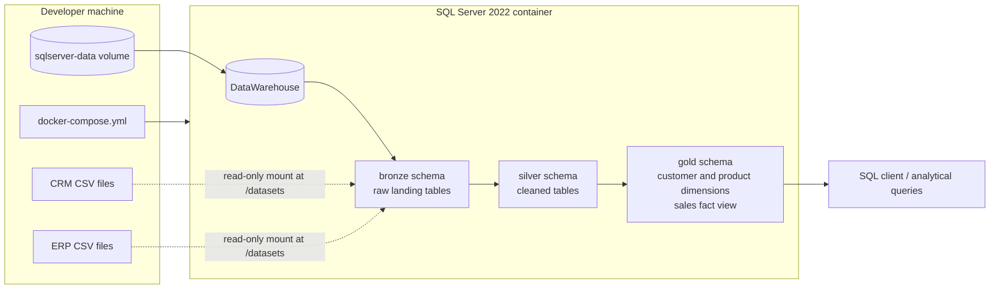

# Data architecture

The project runs Microsoft SQL Server 2022 in Docker Compose. The Compose service publishes SQL Server on `127.0.0.1:1433`, mounts `datasets/` read-only at `/datasets`, and stores SQL Server files in the external Docker volume `sqlserver-data`.

## Layer responsibilities

- **Bronze:** source-shaped tables. `bronze.load_bronze` uses `BULK INSERT` to read the six CSV files from the mounted `/datasets` path.
- **Silver:** typed and standardized tables. `silver.load_silver` applies the transformations implemented in `scripts/silver/proc_load_silver.sql`.
- **Gold:** three views defined in `scripts/gold/ddl_gold.sql`: `gold.dim_customers`, `gold.dim_products`, and `gold.facts_sales`.

The container starts the database engine; it does not automatically run the warehouse initialization or layer scripts. See the root README for the manual setup sequence.
