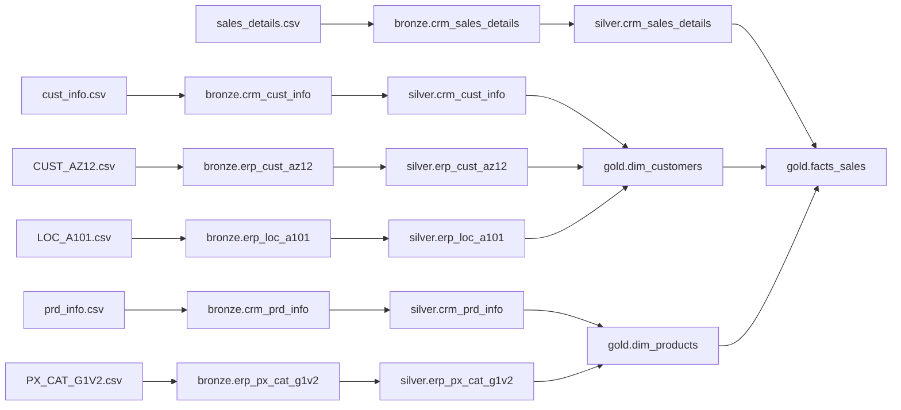

# Data flow and lineage

The flow below reflects the table and procedure names in the repository. The scripts are run manually in a SQL Server client after the database container is available.

## Source-to-layer mapping

| Source file | Bronze table | Silver table | Gold use |
| --- | --- | --- | --- |
| `datasets/source_crm/cust_info.csv` | `bronze.crm_cust_info` | `silver.crm_cust_info` | Customer attributes in `gold.dim_customers` |
| `datasets/source_crm/prd_info.csv` | `bronze.crm_prd_info` | `silver.crm_prd_info` | Current products in `gold.dim_products` |
| `datasets/source_crm/sales_details.csv` | `bronze.crm_sales_details` | `silver.crm_sales_details` | Measures and dates in `gold.facts_sales` |
| `datasets/source_erp/CUST_AZ12.csv` | `bronze.erp_cust_az12` | `silver.erp_cust_az12` | Customer birth date and gender enrichment |
| `datasets/source_erp/LOC_A101.csv` | `bronze.erp_loc_a101` | `silver.erp_loc_a101` | Customer country enrichment |
| `datasets/source_erp/PX_CAT_G1V2.csv` | `bronze.erp_px_cat_g1v2` | `silver.erp_px_cat_g1v2` | Product category attributes |

## Load sequence

1. Run `scripts/init_database.sql` to create the database and schemas.
2. Run the Bronze and Silver DDL scripts to create their tables.
3. Run the Bronze and Silver procedure scripts to define the load procedures.
4. Execute `bronze.load_bronze`, then `silver.load_silver`.
5. Run `scripts/gold/ddl_gold.sql` to create the views.

The procedure scripts use `CREATE OR ALTER PROCEDURE`; the table DDL scripts drop and recreate the target tables. Review the warnings in the root README before rerunning DDL or load procedures because these operations replace table contents.
