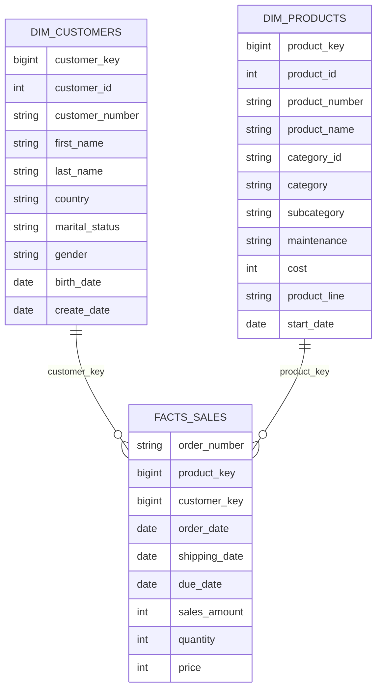

# Gold data model

The Gold layer consists of three SQL views. The customer and product views provide descriptive attributes; the sales view joins the sales records to those views using generated dimension keys.

## View grain and relationships

- **`gold.dim_customers`:** one output row for each customer row selected from `silver.crm_cust_info`, enriched by left joins to ERP customer and location data. `customer_key` is generated with `ROW_NUMBER()` ordered by `cst_id`.
- **`gold.dim_products`:** one output row for each product row in `silver.crm_prd_info` where `prd_end_dt IS NULL`, enriched with ERP category details. `product_key` is generated with `ROW_NUMBER()` ordered by product start date and product key.
- **`gold.facts_sales`:** one output row per input row in `silver.crm_sales_details`; each row is left joined to the customer and product views. The SQL does not declare primary-key or foreign-key constraints for these views.

Because the views use `LEFT JOIN`, a missing dimension match can result in a `NULL` dimension key in `gold.facts_sales`. The generated row-number keys are view outputs, not persisted keys.

See [data_catalog.md](data_catalog.md) for the output columns and [data_quality_checks.md](data_quality_checks.md) for the existing SQL checks.
